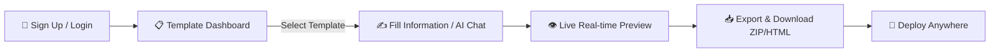

# 🌟 Portfolio.ai — Professional Portfolio Builder

<p align="center">
  
</p>

<p align="center">
  <strong>Design, customize, and export stunning role-tailored portfolio websites in minutes with AI-assisted guidance.</strong>
</p>

<p align="center">
  <a href="https://reactjs.org/"></a>
  <a href="https://firebase.google.com/"></a>
  <a href="https://vercel.com/"></a>
  <a href="https://developer.mozilla.org/en-US/docs/Web/JavaScript"></a>
  <a href="#license"></a>
</p>

---

## 📑 Table of Contents

- [Overview](#-overview)
- [Key Features](#-key-features)
- [Available Templates](#-available-templates)
- [Tech Stack](#-tech-stack)
- [Project Architecture](#-project-architecture)
- [Getting Started](#-getting-started)
  - [Prerequisites](#prerequisites)
  - [Installation](#installation)
  - [Environment Variables](#environment-variables)
  - [Running Locally](#running-locally)
- [Building & Deployment](#-building--deployment)
- [Screenshots & Workflow](#-screenshots--workflow)
- [Contributing](#-contributing)
- [License](#-license)

---

## 🚀 Overview

**Portfolio.ai** is an intuitive, full-featured web platform that eliminates the friction of building personal and professional portfolios. Whether you are a **Software Developer**, **UI/UX Designer**, **Data Scientist**, **Business Analyst**, **Digital Marketer**, or **Music Artist**, Portfolio.ai provides curated, high-converting templates tailored to your craft.

Equipped with an **interactive AI conversational assistant**, real-time live previews, and instant multi-format downloads (standalone HTML/CSS packages or ZIP bundles), building a world-class portfolio has never been easier.

---

## ✨ Key Features

- **🎨 7 Role-Specific Designer Templates**: Crafted specifically for distinct industry roles with appropriate layouts, color psychology, and sections.
- **🤖 AI Floating Assistant (`AIFloatingChat`)**: Step-by-step conversational assistant that asks about your background, skills, and experience to auto-populate your portfolio content.
- **⚡ Instant Real-Time Preview**: Preview your generated portfolio in a live tab with desktop, tablet, and mobile responsiveness before exporting.
- **📦 Multi-Format Export & Downloads**:
  - Standalone, self-contained HTML/CSS source code.
  - Complete `.zip` asset archive download powered by `JSZip` and `file-saver`.
  - Visual snapshot captures via `html2canvas`.
- **📊 Deployment & Portfolio Dashboard**:
  - Manage and track all your created portfolios.
  - Single-click duplication, editing, and deletion.
  - Download history with time filters (Week / Month / All-time).
- **🔐 Secure Firebase Authentication**:
  - Email/Password sign up and sign in.
  - Persistent login state with local browser storage and graceful fallback handling.
  - Protected route guards for user dashboards and builder forms.
- **📱 Fully Responsive Design**: Built with smooth micro-animations, glassmorphic UI elements, and modern CSS typography.

---

## 🎨 Available Templates

| # | Template | Category | Target Audience | Key Highlights |
|:---:|:---|:---|:---|:---|
| **1** | **Software Developer** | Technology | Full Stack, Frontend, Backend | Code-first dark theme, GitHub project showcase, interactive skill chips, live demo links. |
| **2** | **UI/UX Designer** | Creative | Product & UI Designers | Visual case studies, prototype mockups, design philosophy, Figma embeds. |
| **3** | **Data Scientist** | Analytics | ML Engineers & Data Analysts | Metric visualizations with Recharts, research papers, Jupyter notebooks showcase. |
| **4** | **Business Analyst** | Corporate | BI & Strategy Consultants | KPI dashboards, executive summary cards, data impact metrics. |
| **5** | **Digital Marketer** | Growth | Growth Marketers & SEO Leads | Campaign case studies, ROI & conversion metrics, social media reach statistics. |
| **6** | **Music Artist** | Entertainment | Producers, DJs & Musicians | Audio track players, discography showcase, streaming links, upcoming tour dates. |
| **7** | **Terminal & Tech Pro** | Advanced Tech | Cloud & DevOps Engineers | Interactive terminal theme, server/cloud badges, EmailJS contact integration. |

---

## 🛠️ Tech Stack

### **Frontend**
- **Core Library**: [React 18](https://reactjs.org/) (Hooks, Context, Functional Components)
- **Routing**: [React Router v6](https://reactrouter.com/) (Protected Routes, Dynamic Params)
- **Icons**: [React Icons](https://react-icons.github.io/react-icons/) (FontAwesome, Feather, Material)
- **Data Visualization**: [Recharts](https://recharts.org/) (Interactive analytics and metric charts)
- **Packaging & Exports**: [JSZip](https://stuk.github.io/jszip/), [FileSaver.js](https://github.com/eligrey/FileSaver.js/), [html2canvas](https://html2canvas.hertzen.com/)
- **Contact Forms**: [EmailJS](https://www.emailjs.com/)

### **Backend & Services**
- **Authentication**: [Firebase Authentication](https://firebase.google.com/products/auth) (Email/Password, persistent session handling)
- **Database / Storage**: Firebase Firestore & Cloud Storage

### **Deployment & DevOps**
- **Hosting Platform**: [Vercel](https://vercel.com/)
- **Build Tooling**: `react-scripts 5.0.1`

---

## 📂 Project Architecture

```plaintext
portfolio-builder/
├── public/                     # Static HTML template & public assets
│   ├── favicon.ico
│   ├── index.html
│   └── manifest.json
├── src/
│   ├── components/
│   │   ├── ai/                 # AI Floating Assistant component & styles
│   │   │   ├── AIFloatingChat.jsx
│   │   │   └── AIFloatingChat.css
│   │   ├── auth/               # Login & Signup forms with Firebase Auth
│   │   │   └── LoginSignup.jsx
│   │   ├── builder/            # Template-specific customization forms
│   │   │   └── TemplateForms/  # Template 1 through 7 Builder Forms
│   │   ├── common/             # Reusable UI components (Header, Navigation)
│   │   │   └── Header.jsx
│   │   ├── dashboard/          # User Dashboard & Downloads manager
│   │   │   ├── ExampleDashboard.jsx
│   │   │   ├── DeploymentsDashboard.jsx
│   │   │   └── PortfolioCard.jsx
│   │   ├── preview/            # Live portfolio preview renderers
│   │   │   ├── Preview.jsx
│   │   │   └── Preview7.jsx
│   │   └── templates/          # Ready-to-render portfolio templates (1 - 7)
│   │       ├── Template1.js ... Template7.js
│   │       └── TemplateStyle.css
│   ├── firebase/               # Firebase app & authentication configuration
│   │   └── firebase.js
│   ├── utils/                  # AI helpers, deployment & template parsers
│   │   ├── aiHelper.js
│   │   ├── deploymentService.js
│   │   └── templateParser.js
│   ├── App.js                  # Main Application router & ProtectedRoute
│   ├── index.js                # React DOM entry point
│   └── vercel.json             # Vercel SPA routing & build configuration
├── .gitignore
├── package.json
└── README.md
```

---

## ⚡ Getting Started

### Prerequisites

Ensure you have the following installed on your local machine:
- **Node.js** `>= 16.0.0` ([Download Node.js](https://nodejs.org/))
- **npm** `>= 8.0.0` or **yarn**

### Installation

1. **Clone the repository:**
   ```bash
   git clone https://github.com/Vaishnavijamkhandi/portfolio-builder.git
   cd portfolio-builder
   ```

2. **Install project dependencies:**
   ```bash
   npm install --legacy-peer-deps
   ```

### Environment Variables

Create a `.env` file in the root directory and add your Firebase credentials:

```env
REACT_APP_FIREBASE_API_KEY=your_firebase_api_key
REACT_APP_FIREBASE_AUTH_DOMAIN=your_project.firebaseapp.com
REACT_APP_FIREBASE_PROJECT_ID=your_project_id
REACT_APP_FIREBASE_STORAGE_BUCKET=your_project.firebasestorage.app
REACT_APP_FIREBASE_MESSAGING_SENDER_ID=your_sender_id
REACT_APP_FIREBASE_APP_ID=your_app_id
```

> **Note:** The application includes development fallback credentials for local testing, but using your own Firebase project is recommended for production.

### Running Locally

Start the React development server:

```bash
npm start
```

Visit [http://localhost:3000](http://localhost:3000) in your browser. The page will automatically reload whenever you make changes.

---

## 🚢 Building & Deployment

### Production Build

To compile a minified, production-ready build:

```bash
npm run build
```

This generates an optimized static bundle in the `build/` directory.

### Deploying to Vercel

The project includes a ready-to-use [`vercel.json`](./vercel.json) file configured for Single Page Application (SPA) routing.

1. Install the Vercel CLI or import the repository in [Vercel Dashboard](https://vercel.com/new).
2. Configure your Environment Variables in the Vercel Project Settings.
3. Deploy:
   ```bash
   vercel --prod
   ```

---

## 🔄 User Workflow



1. **Authenticate**: Create an account or log in via Firebase Authentication.
2. **Choose Template**: Browse 7 industry-specific templates on the main dashboard.
3. **Fill Information**: Use the dedicated builder form or chat with the **AI Assistant** to automatically fill in details.
4. **Preview**: Verify your design, typography, projects, and contact info in live preview mode.
5. **Download & Share**: Export your portfolio as a complete HTML/CSS bundle or ZIP file ready for GitHub Pages, Netlify, or Vercel.

---

## 🤝 Contributing

Contributions, issues, and feature requests are welcome!

1. Fork the Project
2. Create your Feature Branch (`git checkout -b feature/AmazingFeature`)
3. Commit your Changes (`git commit -m "Add some AmazingFeature"`)
4. Push to the Branch (`git push origin feature/AmazingFeature`)
5. Open a Pull Request

---

## 📄 License

This project is licensed under the [MIT License](LICENSE).

---

<p align="center">
  Crafted with ❤️ by <a href="https://github.com/Vaishnavijamkhandi"><strong>Vaishnavi Jamkhandi</strong></a>
</p>
